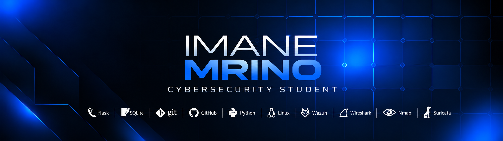
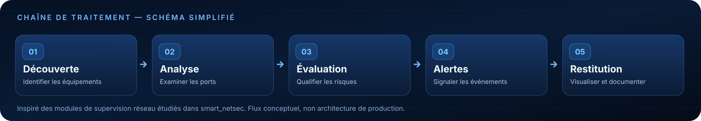

<!-- Profil GitHub : https://github.com/imane88-lgtm -->

  

   
   

  <strong>RÉSEAUX · CYBERSÉCURITÉ DÉFENSIVE · SOC / BLUE TEAM</strong>
   
  Comprendre les réseaux. Rendre la sécurité plus claire.

   
   

  
  &nbsp;
  
  &nbsp;
  

 

## 01 — À propos de moi

Je suis **Imane Mrino**, étudiante en **Bachelor Réseaux, Cloud et Cybersécurité à l’EST Kelaa des Sraghna**, après un **DUT en Sécurité Informatique et Réseaux à l’EST Béni-Mellal**.

Je m'intéresse à la **cybersécurité défensive** : comprendre les infrastructures, analyser les événements de sécurité et développer des outils qui facilitent la supervision et l'identification des risques.

Mes stages chez **CIMAT** et **Ménara Préfa** m'ont permis de découvrir l'infrastructure réseau en entreprise et de participer au développement d'une plateforme de supervision. Mon objectif est d'évoluer vers le métier d'**analyste SOC junior** grâce à des projets concrets, des laboratoires pratiques et une documentation technique rigoureuse.

 

## 02 — Technologies & développement

  <table>
    <tr>
      <td align="center" width="124"> <strong>Python</strong></td>
      <td align="center" width="124"><picture><source media="(prefers-color-scheme: dark)" srcset="https://cdn.simpleicons.org/flask/FFFFFF"/></picture> <strong>Flask</strong></td>
      <td align="center" width="124"> <strong>SQLite</strong></td>
      <td align="center" width="124"> <strong>Git</strong></td>
      <td align="center" width="124"><picture><source media="(prefers-color-scheme: dark)" srcset="https://cdn.simpleicons.org/github/FFFFFF"/></picture> <strong>GitHub</strong></td>
    </tr>
  </table>

**Domaines pratiqués :** réseaux TCP/IP · découverte réseau · analyse des ports ouverts · évaluation des risques · logique d'alerte · interfaces Flask · documentation technique.

 

## 03 — Outils de cybersécurité & apprentissage

  <table>
    <tr>
      <td align="center" width="130"> <strong>Wireshark</strong></td>
      <td align="center" width="130"> <strong>Nmap</strong></td>
      <td align="center" width="130"> <strong>Linux</strong></td>
      <td align="center" width="130"> <strong>Wazuh</strong></td>
    </tr>
  </table>

> **En cours d'apprentissage :** Linux, analyse de trafic avec Wireshark, exploration réseau avec Nmap, **Wazuh**, lecture d'événements Suricata et investigation d'alertes. Ces technologies sont des axes de progression, pas des certifications ou des niveaux de maîtrise revendiqués.

 

## 04 — Projets sélectionnés

<table>
  <tr>
    <td width="50%" valign="top">
      <h3>smart_netsec</h3>
      
<strong>Analyse et supervision de sécurité réseau</strong>

      
Projet réalisé dans le cadre d'un stage technique : découverte réseau, analyse des ports exposés, évaluation des risques, génération d'alertes et restitution via Flask et SQLite.

      
<strong>Technologies :</strong> Python · Flask · SQLite

      

    </td>
    <td width="50%" valign="top">
      <h3>SentraGuard</h3>
      
<strong>Prototype de supervision de sécurité locale</strong>

      
Projet pédagogique explorant l'observation des événements de sécurité, la logique de détection et le suivi des alertes à travers une interface de supervision.

      
<strong>Domaines :</strong> Supervision · Détection · Alertes

      

    </td>
  </tr>
</table>

Les fonctions et les limites des projets sont détaillées dans leurs dépôts respectifs.

 

## 05 — Ma démarche technique

Cette chaîne illustre **les étapes conceptuelles** de mon travail en supervision de réseau :

  

 

## 06 — Mon objectif professionnel

Je souhaite approfondir les compétences nécessaires à un poste d'**analyste SOC junior**, notamment l'analyse de journaux, la qualification des alertes, les outils SIEM / IDS et les démarches d'investigation.

Mon approche : **apprendre, construire, tester, documenter et améliorer.**

 

---

  <strong>Une opportunité en cybersécurité ou un projet à partager ?</strong>
    
  
  &nbsp;
  
  &nbsp;
  
    
  Imane Mrino · Réseaux, Cloud et Cybersécurité · Maroc

